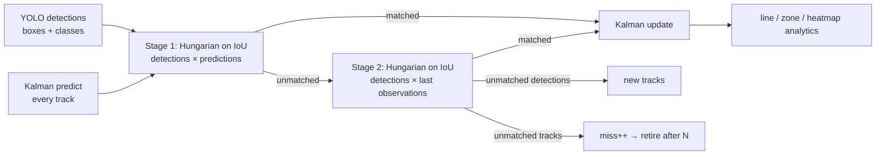

# object-counter

**Count people, vehicles or anything YOLO can see, from any video, webcam or RTSP stream.** Detection uses Ultralytics YOLO11, and the multi-object tracker is **written from scratch** here: a Kalman filter per object, Hungarian matching, plus an observation-centric recovery stage. On top of that sit directional line counting, zone dwell time and motion heatmaps.

  

<!-- author-banner -->
> **Project 06 of 20** in my AI build series, designed and built by **[Abbishekk DGS](https://abbishekkdgs.tech)**. [See all projects →](https://github.com/Abbishekk-DGS)

## What you get

- **Directional line counting**: IN / OUT per class. Each object is counted at most once per direction, so people lingering on the line don't inflate numbers
- **Zone analytics**: dwell time per object inside any polygon (queues, counters, restricted areas)
- **Motion heatmap** overlay
- **Outputs**: annotated video, `events.csv` (frame, track, class, direction), `summary.json`
- Resolution-independent config: lines and zones are given as frame fractions
- Works with any Ultralytics model (`yolo11n` → `yolo11x`, custom-trained weights)

## Results

[Intel sample video](https://github.com/intel-iot-devkit/sample-videos) `people-detection.mp4` (768×432, 596 frames), YOLO11n, on an 8 GB Apple Silicon Mac:

| Metric | Value |
|---|---|
| Throughput | **~23 fps** end-to-end (detect + track + annotate + encode) |
| Line events | 3 (1 out, 2 in) |
| Unique tracks | 12 |

## Quickstart

```bash
git clone https://github.com/Abbishekk-DGS/object-counter && cd object-counter
uv sync

# people crossing a vertical line through the middle of the frame
uv run object-counter mall.mp4 --classes person --line 0.5,0,0.5,1

# traffic: vehicles crossing a horizontal line, with heatmap
uv run object-counter traffic.mp4 --classes car,truck,bus,motorcycle --line 0,0.6,1,0.6 --heatmap

# dwell time inside a polygon, live webcam preview
uv run object-counter 0 --zone 0.1,0.5,0.4,0.5,0.4,0.9,0.1,0.9 --show
```

The first run downloads `yolo11n.pt` (~6 MB).

## How the tracker works



- **State**: `[cx, cy, area, aspect, vx, vy, v_area]` with a constant-velocity model ([SORT](https://arxiv.org/abs/1602.00763)).
- **Class-gated matching**: a car can never inherit a person's ID.
- **Observation-centric recovery** ([OC-SORT](https://arxiv.org/abs/2203.14360) idea): when an object stops or reverses, the Kalman prediction overshoots and the IoU match fails. A second pass matches leftovers against each track's *last real box*. The test suite includes this exact case: without stage 2 the walker gets a new ID and is counted twice.
- **Crossing test**: a segment-intersection check between the line and the track's movement each frame, using cross-product signs. It's exact and needs no "line zone" heuristics.

## Tests

```bash
uv sync --extra dev && uv run pytest -q
```

Tests are synthetic and need no model: stable IDs for objects passing each other, survival through a 3-frame occlusion, class gating, no double-count on reversal, once-per-direction counting, zone dwell time and heatmap accumulation.

## About the author

Built by **Abbishekk DGS**. More of my work at **[abbishekkdgs.tech](https://abbishekkdgs.tech)** and on **[GitHub](https://github.com/Abbishekk-DGS)**.

## License

AGPL-3.0, to match the Ultralytics YOLO dependency. The tracker and analytics modules (`tracker.py`, `analytics.py`) are self-contained and only depend on numpy and scipy.
